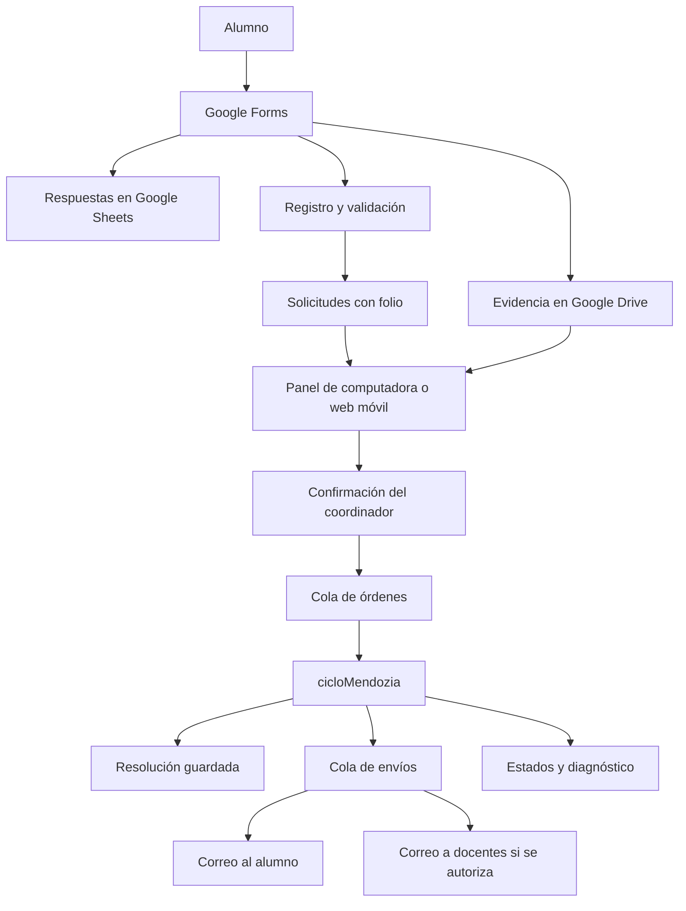

# Funcionamiento y arquitectura de MENDOZIA 3.0

[← Presentación](../README.md)

## Necesidad que atiende

El proceso de partida consistía en recibir evidencias de los alumnos, decidir si procedía justificar las faltas y comunicar la autorización a los docentes por WhatsApp. MENDOZIA concentra la recepción y el seguimiento en Google, y genera los avisos por correo después de la confirmación del coordinador.

Presentar una solicitud no equivale a obtener un justificante: la resolución sigue siendo humana.

## Componentes de la entrega revisada

| Componente | Responsabilidad |
| --- | --- |
| Google Forms | Captura de solicitudes, correo del respondente y carga de evidencia. |
| Google Sheets | Catálogos, respuestas originales, solicitudes, configuración, órdenes y registro de envíos. |
| Google Drive | Almacenamiento y permisos de la evidencia. |
| MotorV3.gs | Registro, validación, recuperación, procesamiento de decisiones, correos, diagnóstico y sincronización. |
| PanelV3.gs y panel3.html | Panel lateral para operar desde el libro en computadora. |
| MovilV3.gs y movil3.html | Aplicación web para buscar y revisar solicitudes desde el navegador del celular. |
| MailApp | Envío de avisos desde el contexto autorizado del motor. |

La entrega revisada no contiene una definición de aplicación AppSheet: sus pantallas operativas están implementadas con HTML y Apps Script. La documentación inicial se ajustó al código de la versión 3.

## Dos proyectos de Apps Script

El **proyecto del motor** conserva las propiedades de instalación, los identificadores del formulario y del libro y los activadores de procesamiento.

El **proyecto vinculado al libro** contiene el panel lateral y la web móvil. Se comunica con el motor mediante una cola de órdenes guardada en el mismo libro. La web reutiliza el flujo de confirmación y envío; no crea un sistema separado de solicitudes.

Algunas funciones y hojas conservan nombres internos como **IRIS** por compatibilidad. El nombre visible del producto es **MENDOZIA**.

## Recorrido de la información

## Información organizada en el libro

| Hoja | Contenido |
| --- | --- |
| Grupos | Catálogo de grupos. |
| Alumnos | Matrícula, nombre, grupo y correo institucional. |
| Maestros | Nombre, correo y grupos atendidos. |
| Respuestas | Registro original vinculado al formulario. |
| Solicitudes | Folio, datos del alumno, días solicitados y autorizados, evidencia, validación, resolución y notificación. |
| Configuración | Opciones del sistema, coordinador, dominio y resultado de actualización. |
| Envíos | Registro por aviso y destinatario, con estado y detalle. |
| IRIS órdenes | Cola interna de confirmaciones y reenvíos. |
| Errores MENDOZIA | Proceso, referencia, error, intentos y estado de resolución; admite el nombre histórico Errores Mendoza. |

Los catálogos y las solicitudes se consultan por encabezados. Reordenar columnas es compatible mientras los títulos requeridos sigan presentes y no estén duplicados.

## Reglas implementadas

- El formulario organiza las opciones de alumnos por grupo, mostrando matrícula y nombre.
- La versión revisada permite días de lunes a viernes dentro de los **15 días naturales anteriores**, excluyendo el día actual y las fechas futuras. No equivale a 15 días hábiles ni incorpora por sí misma un calendario de festivos.
- El registro valida el dominio institucional y la correspondencia entre el correo verificado y el alumno seleccionado, además de comprobar el catálogo y las fechas.
- Solo pueden autorizarse días incluidos en la solicitud original. El rechazo requiere observaciones.
- La casilla de confirmación del libro es informativa: editarla no autoriza ni reenvía.
- El panel y la web registran una orden explícita. Sus identificadores, la comprobación de cambios y los bloqueos evitan procesar nuevamente la misma confirmación.
- Los reenvíos utilizan una acción específica y conservan los datos y destinatarios de la resolución guardada.

## Correos y privacidad de la evidencia

El aviso inicial al coordinador incluye los datos de la solicitud y un acceso al libro. El motor concede al coordinador acceso de lectura a la evidencia sin hacer públicos los archivos.

Al autorizar, se avisa al alumno y a los docentes configurados para el grupo. El alumno recibe los días autorizados y los solicitados que no fueron autorizados. El aviso docente enumera exclusivamente las fechas autorizadas y permite omitir aquellas en las que no impartió clase.

Al rechazar, se avisa al alumno con las observaciones. Los avisos a docentes no incorporan el motivo privado ni enlaces a la evidencia.

## Seguridad y responsabilidades

**Google proporciona la infraestructura y los mecanismos base de autenticación, autorización y permisos de los servicios institucionales ya contratados.** MENDOZIA añade las reglas del proceso y la validación de sus dos cuentas operadoras.

Para la web versión 3, la configuración prevista es ejecutar como **usuario que accede**, con acceso de la organización. Después, cada consulta y confirmación comprueba que la identidad activa coincida con la efectiva y que pertenezca al propietario o al coordinador. Pertenecer al dominio institucional no basta para operar el panel.

El coordinador debe conservar sus permisos sobre el libro y la evidencia. La configuración de Google y la autorización que comprueba el código son controles complementarios.

Este repositorio no publica expedientes, evidencias, direcciones de alumnos ni URLs operativas.

## Referencias oficiales de la plataforma

- [Seguridad en AppSheet](https://support.google.com/appsheet/answer/10105078), como referencia de la herramienta mencionada inicialmente; no describe la implementación HTML de la versión 3.
- [Compartir archivos y administrar acceso en Drive](https://support.google.com/drive/answer/7166529).
- [Autorización de servicios en Apps Script](https://developers.google.com/apps-script/guides/services/authorization).
- [Publicación de aplicaciones web en Apps Script](https://developers.google.com/apps-script/guides/web).
